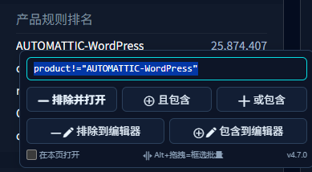
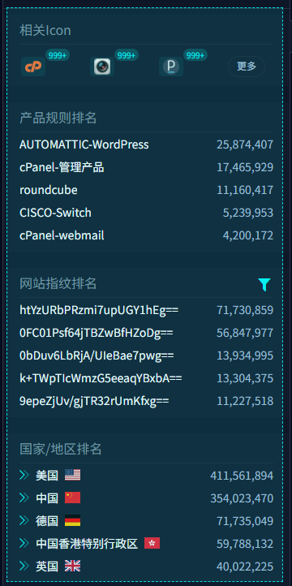
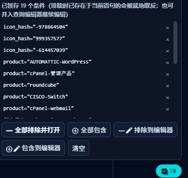
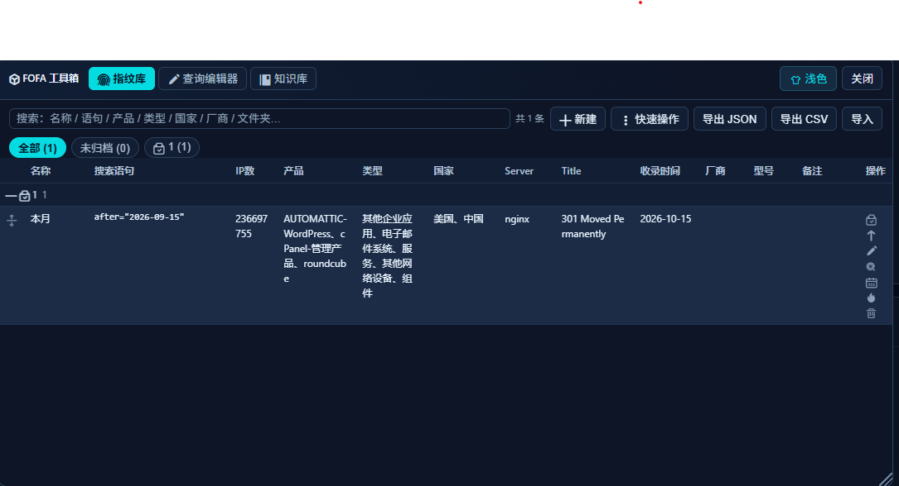
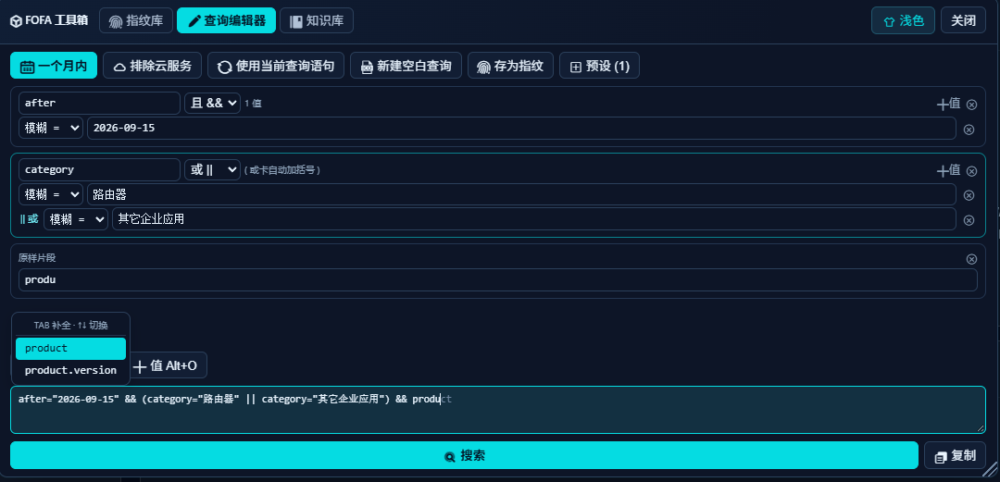
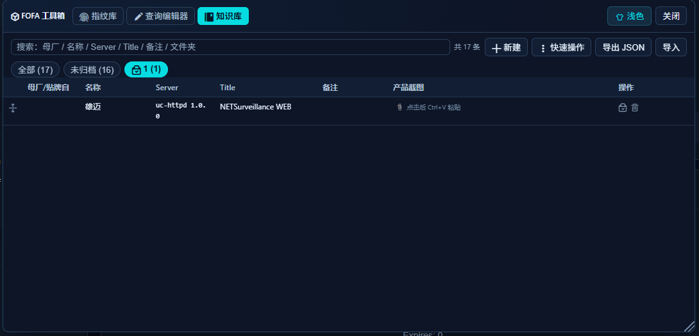

# FOFA工具箱

主要面向IOT安全的信息面搜集制作的fofa页面增强工具脚本，如果有好的功能建议欢迎向我提出！

# 功能简介

- **[右键增强](#右键增强)**：结果页上几乎任何元素——文字、图标、国旗、甚至世界地图————右键即可把该项作为条件(或取反条件)追加到当前搜索语句，或发送到查询编辑器进一步编辑；
- **[页面批量处理](#页面批量处理)**：逐条暂存处理、或 Alt + 左键拖拽框选一片区域，把一批条件一次性全部排除/包含，或作为字段卡并入查询编辑器继续加工；
- **[指纹记录库](#指纹收藏)**：把当前搜索语句连同独立 IP 数、产品、类型、国家、Server、Title 等排名信息一键存档，表格式编辑、置顶、搜索过滤，有简单的文件夹分组、内置了几个快速操作（去重 / 删除地区限定 / 批量移动）、JSON/CSV 导出与导入，并且可以可发送到查询编辑器继续加工，数据全部存在浏览器本地；
- **[查询编辑器](#查询编辑器)**：将搜索语句切分，可以分段地编辑，底部完整语句框可直接编辑并与卡片实时互通，支持简单的语法补齐，体验向各个终端的美化看齐（灰字幽灵文本 + 候选下拉），可以把用的多的查询片段存为预设来快速编辑，独立管理浮层支持新建/编辑/分组/排序/搜索/导入导出/插入/覆盖。内置了几个我自己常用且我认为比较通用的语法，可以直接插入(一键「一个月内 / 排除云服务)，也可以新建空白查询语句。
- **[知识库](#知识库)**：自己用来记录IOT信息的小功能，记一下厂商的server、title和贴牌关系，还可以记录截图，帮自己快速回顾一个设备的基本信息面。

> 一个小细节：新标签页经 `window.open` 打开，保留 opener 关系——Tree Style Tab 等树状标签插件会将其挂为当前标签的子标签。

指纹库、查询编辑器、知识库合并在任一fofa页面左下角**工具箱**窗口的三个标签页里。

# 安装使用

1. 浏览器需要先安装 [Tampermonkey](https://www.tampermonkey.net/) 扩展；
2. Tampermonkey → 添加新脚本 → 粘贴 `fofa-toolbox.user.js` 全文 → `Ctrl+S` 保存；
3. Chrome（Manifest V3）需在 `chrome://extensions` → Tampermonkey → 详情中开启「允许运行用户脚本」；
4. 打开 FOFA 任意页面，左下角会出现工具箱图标

# 功能展示

## 右键增强

## 页面批量处理

## 指纹收藏

## 查询编辑器

## 知识库
